# Sprint 3 - Developing a Minimum Viable Product (MVP)

## Sprint Goals

Continue to develop the web application to the point that it provides all key functionality of the system. Test and refine it so that it can serve as the basis for the final phase of development.

### Specific Goals

- Create the following web pages:
    - login page for users to login
    - 
    - Etc.
- Develop SQL database queries to:
    - Add a new ...
    - Etc.

## Testing users can login 

I am testing that users can login to the website, and that the UI changes when I login. I am also testing that users cannot view hunt specifics while being logged out. 

Login changes include:
- Signup button disappears when user is logged in
- Login button gets replaced with logout button
- Profile button appears. 

Hunts should then be able to be clicked on when logged in. 

Logging in:
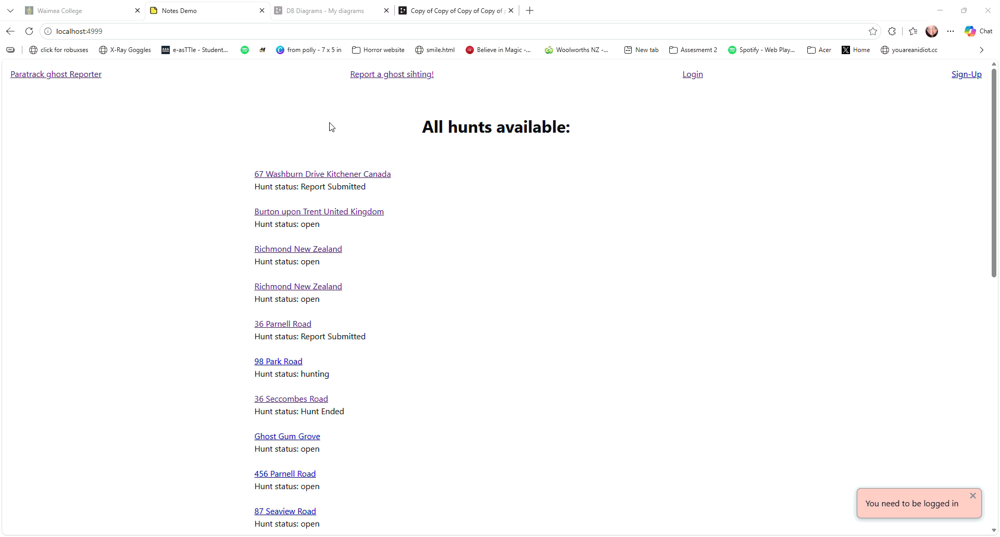

From the video, hunts become clickable when you login, and the UI changes. 

### Changes / Improvements
As this worked as intended, there was no need for changes. 

## Testing Ghost locations get displayed on a map.

I am testing that the ghost location displays on a map in the hunt page. 

Location of the hunt: 

Location the map displays: 
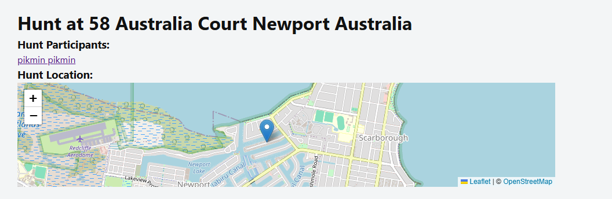

Actual place:
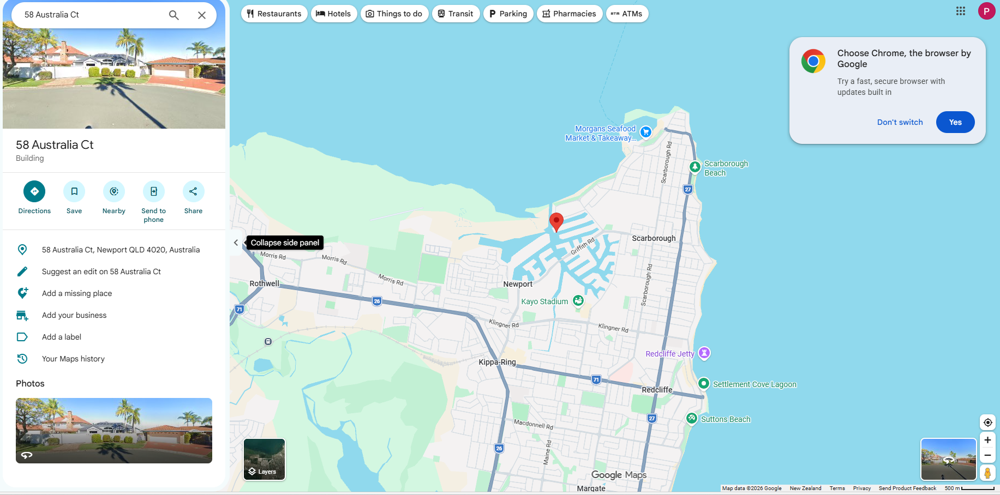

The map works as intended. 

### Changes / Improvements

As this feature works as intended, there is no need for changes. 

## Testing messages live update on the website

Testing messages live update on the website, without the user having to reload for new messages. 

Pikmin account sending messages to the hunt: 

### Changes / Improvements

As the website works as intended, there is no need for changes. 

## Testing hunts/hunt statuses appear correctly on the home page. 
Similar to the test in sprint 2, I am this time testing that the status appear next to them, and they are clickable. 

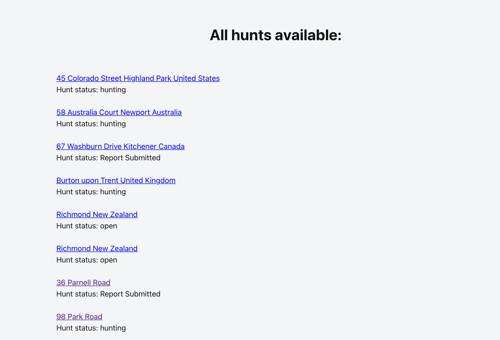

### Changes / Improvements

I decided it could be helpful/interesting to current/potential users if a map at the top of the screen showed the pins of all the hunts currently in the database; similar to the one on the hunt page. 

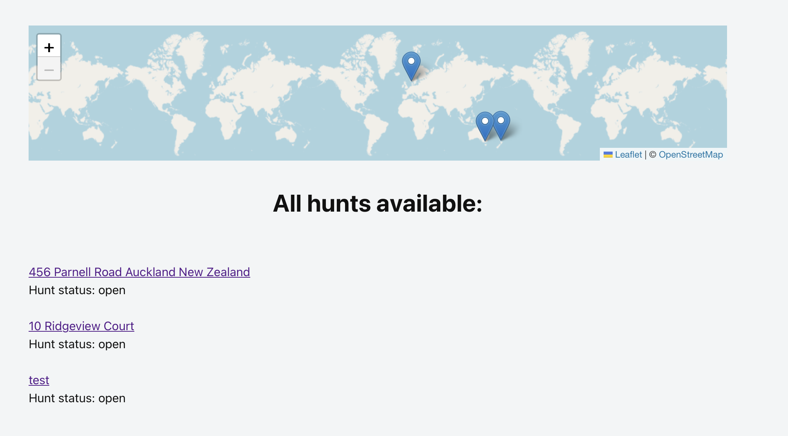

This can help draw in potential users by seeing if there are ghost locations near them. This also included a database change.

New database:
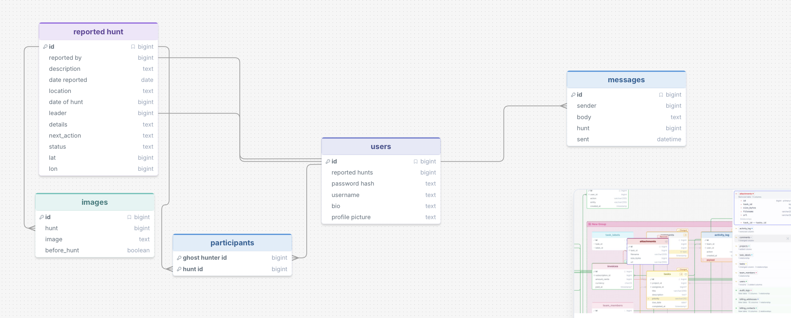

*Note: The lat/lon columns are of type real, not of bigint. Bigint doesn't store decimals, SQLite doesn't have a type decimal, and because they store GPS co-ords I need them to store decimals; hence real. DrawSQL doesn't have an option for real type so I went with bigint. 

I then also decided it would look better again if I added popups to the markers with the address of the ghost sighting. 

Map popup when you click on the markers: 
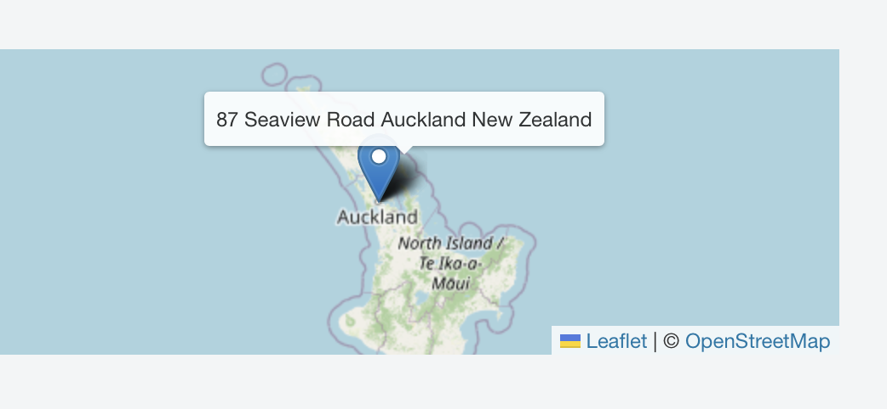

## Testing addresses autofill on the report page. 

I am testing that I can start typing an address and that it will autofill. 

Testing autofill by typing in addresses both kiwi and then from overseas: 

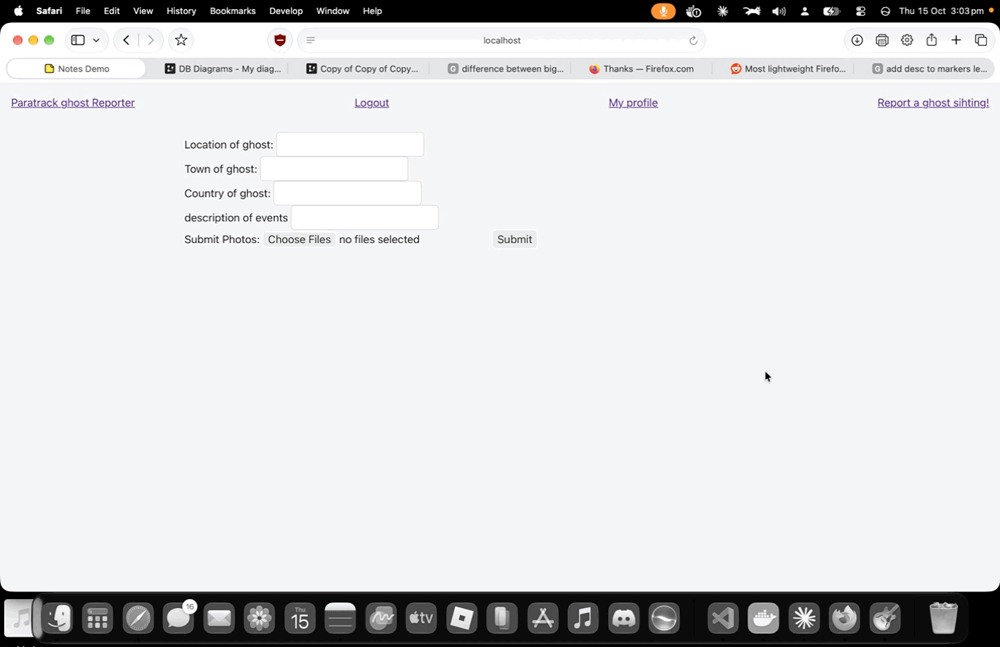

### Changes / Improvements

As the website works as intended, there is no need for changes here. 

## Testing users can signup to hunts

I am testing users can signup to huns, and the hutns they have signed up to show up on the home page.

Joining a hunt
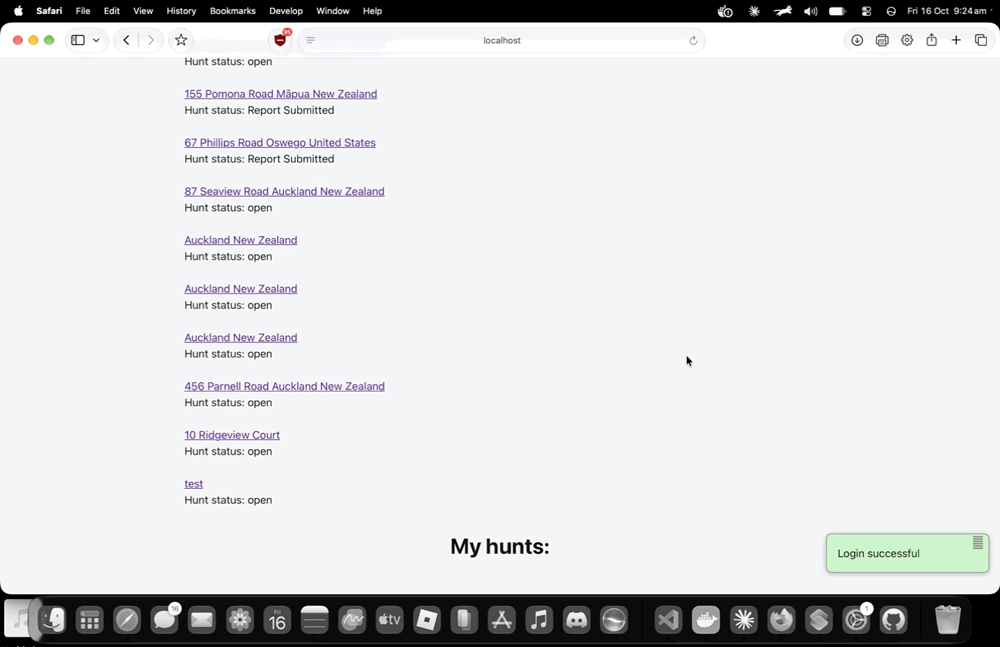

### Changes / Improvements

While hunts could correctly be joined, I decided it would be better that if the user hadn't joined any hunts it woul'd say join hunt on the bottom. 

After:
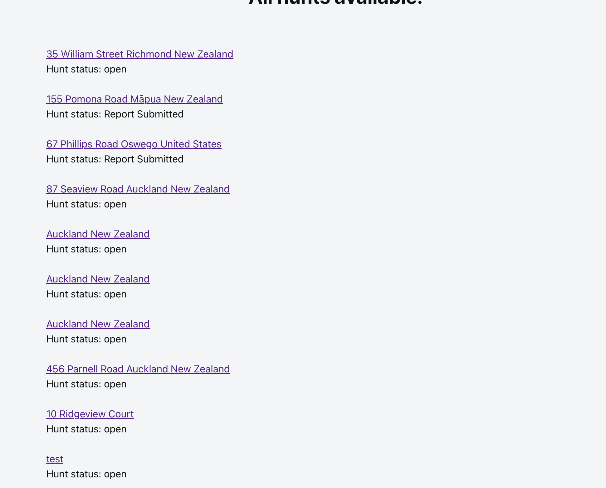

## Testing users can upload images and change their profile picture:

I am testing users can vupload images to change their profile picture. 

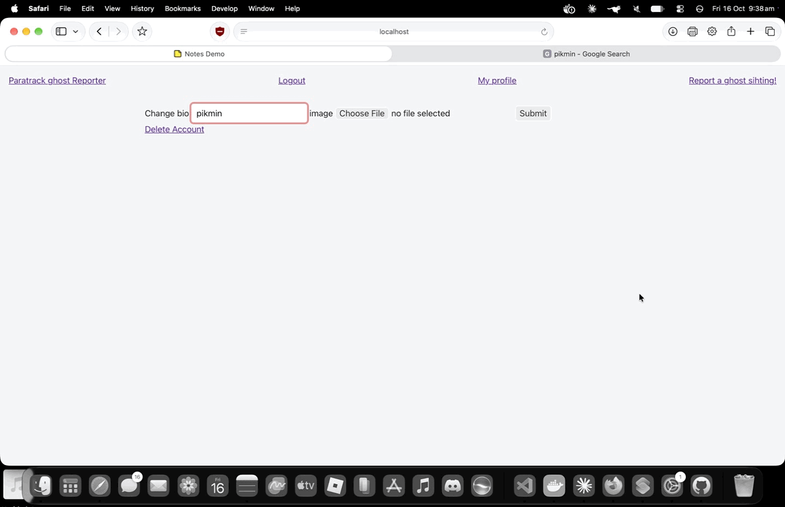

### Changes / Improvements

No changes were needed

## Sprint Review

Replace this text with a statement about how the sprint has moved the project forward - key success point, any things that didn't go so well, etc.

