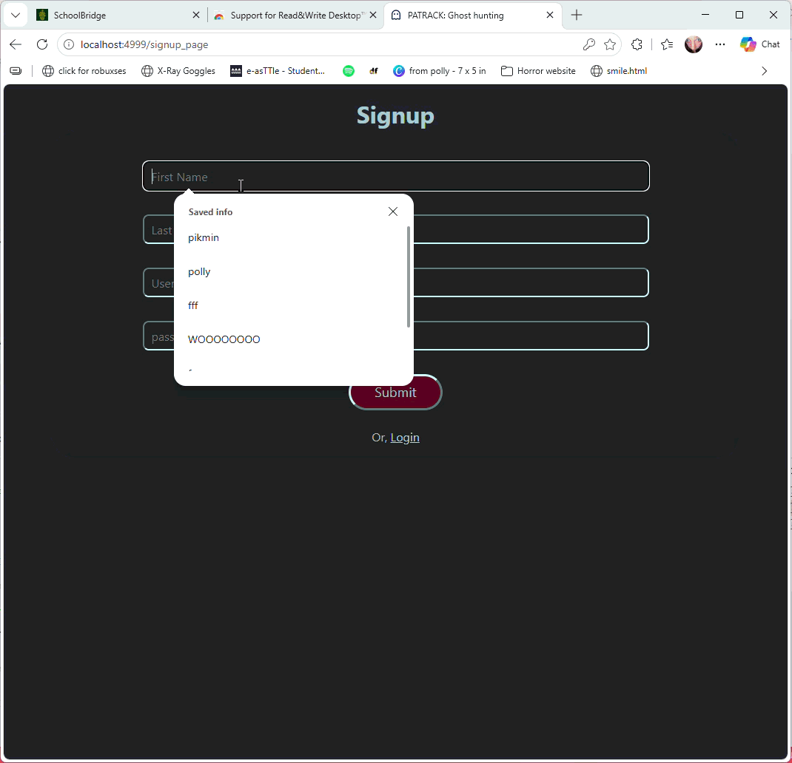
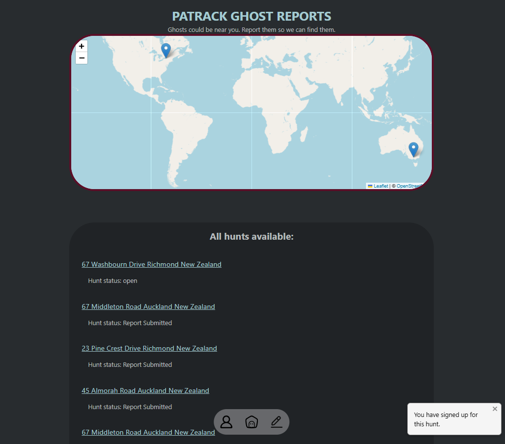
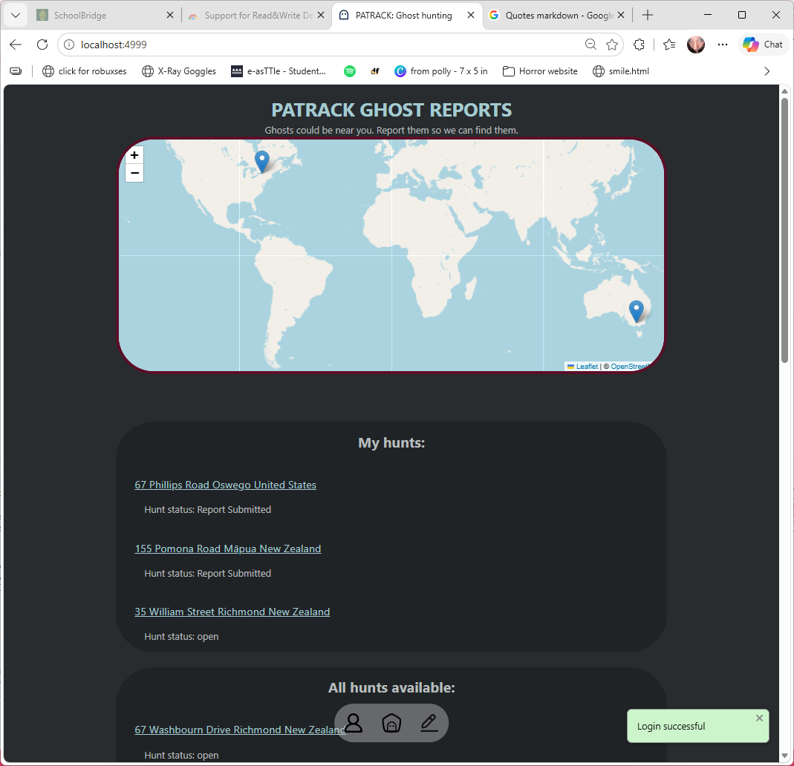
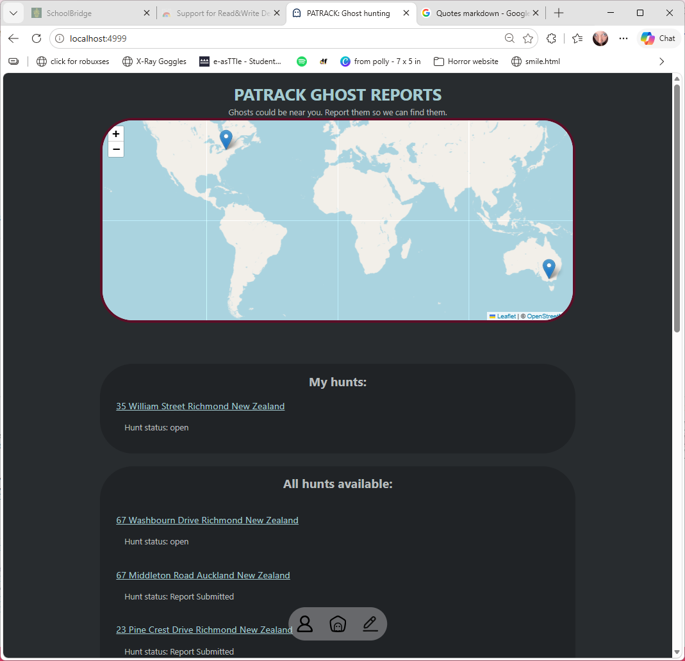
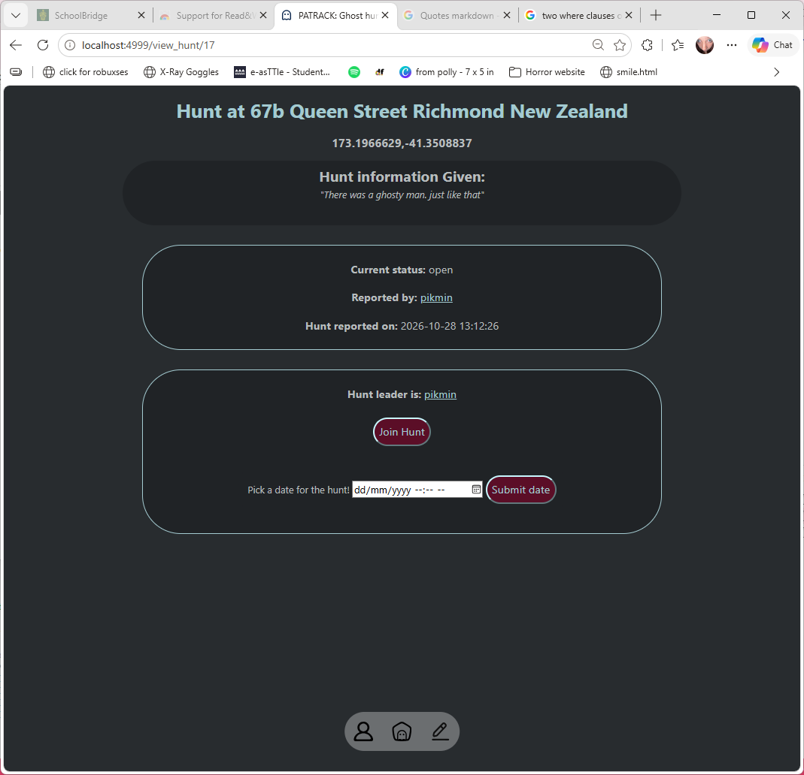
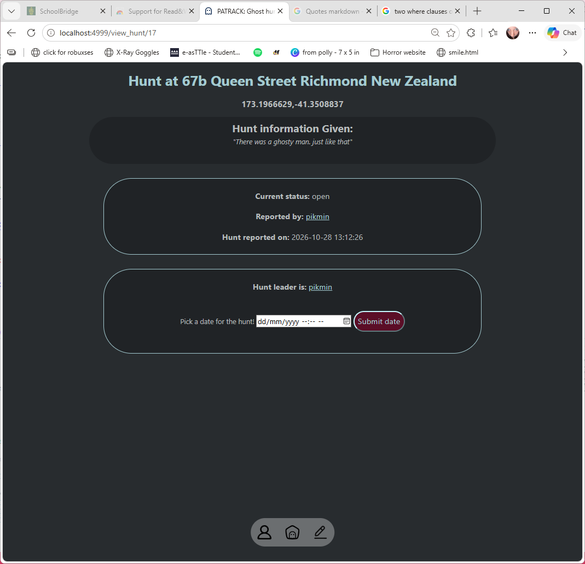
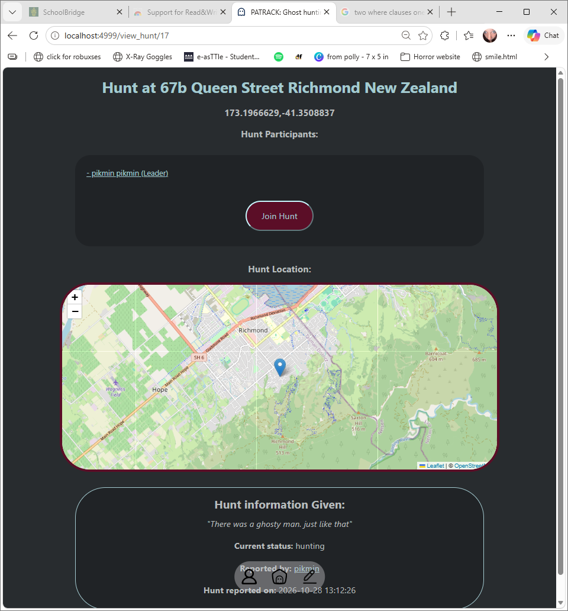
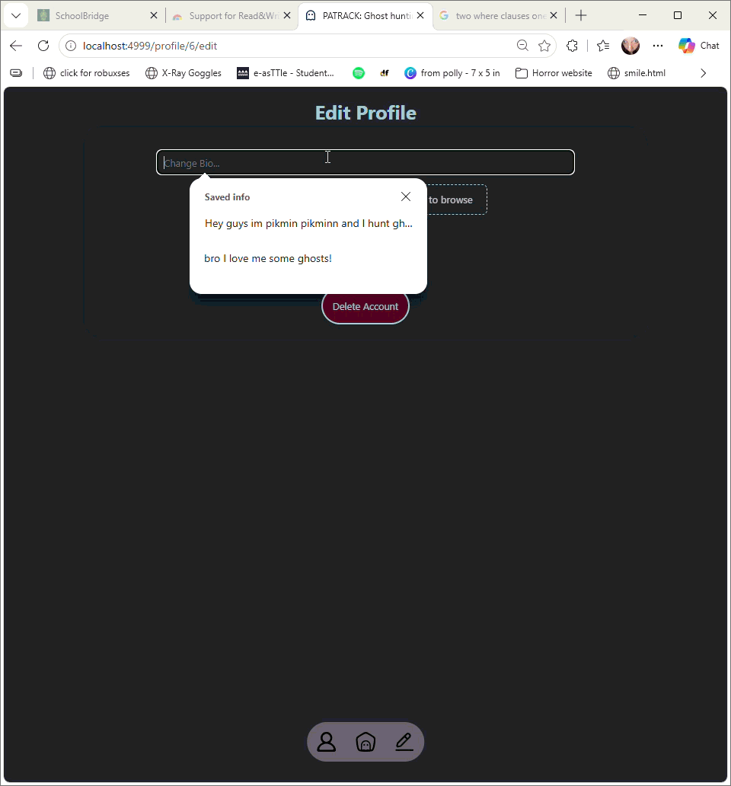
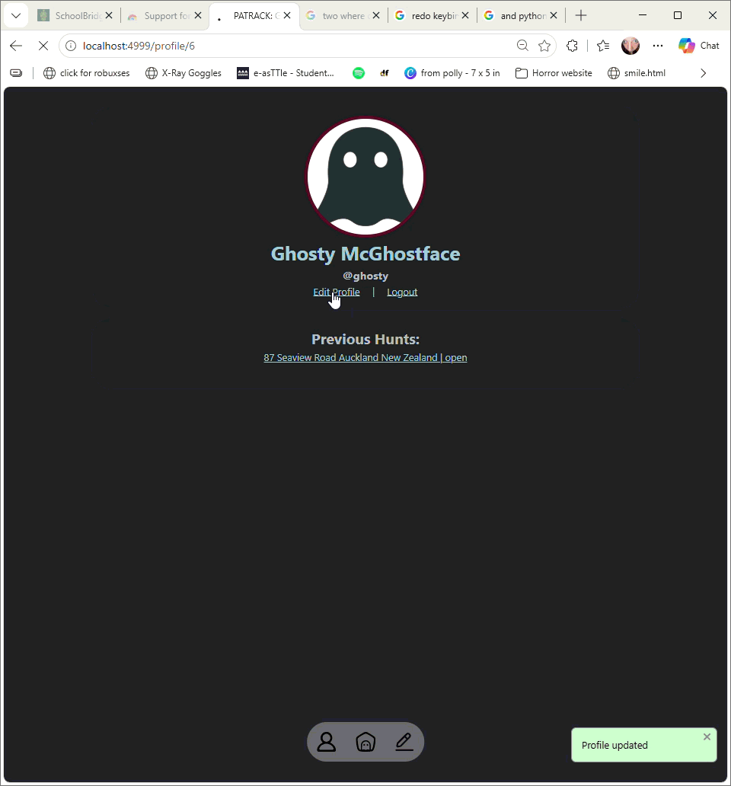

# Sprint 4 - Developing a Refined and Complete System

## Sprint Goals

Develop the system until it is fully featured, with a refined UI and it satisfies the requirements. The system will be fully tested at this point.

### Specific Goals

- Refine the design and UI of the website
- Refine the user experience (UX) of the system
- Perform final, full-system testing

## Testing reporting ghosts with my end users. 

Testing reporting ghost sightings with my end users.  tested it, and the outcome of the testing

**PLACE SCREENSHOTS AND/OR ANIMATED GIFS OF THE TESTING HERE**

### Changes / Improvements

Replace this text with notes any improvements you made as a result of the testing.

**PLACE SCREENSHOTS AND/OR ANIMATED GIFS OF THE IMPROVED SYSTEM HERE**

## Testing users can login

End users noticed that usernames were always stored as lowercase, even if submitted with some uppercase letters. 
This made logging in frustrating. 

### Changes / Improvements

To combat this, I removed the force lowercase, and added a force lowercase to the check when logging in. This means that users can enter their username in a case, but not have to remember the case when logged in. 

## Testing home screen with the users

Testing my home screen with the useres. I showed my home screen to   my users and they gave me the feedback

> It would be more helpful if "My hunts" was at the top. 

### Changes / Improvements

To fix this, I moved "My hunts" to the top:

Original (My hunts at the bottom)

New: 

Taking this back to my end users, they said: 
> If I have lots of finished hunts, it will be hard to see new hunts without scrolling heaps. 

To fix this, I changed it so that a hunt won't display in 'my hunts' if its status is 'Report Submitted'.

Before: 

After:

Presenting this design to the end users, they said it was a good solution. 

## Testing joining hunts 

Testing users can join hunts by presenting the hunt page to my end users and letting them use it.   

I received the following feedback: 

> It would be good if, once I've signed up to a hunt, the 'Join Hunt' button goes away. 

### Changes / Improvements

To fix this, I added a 'signed up' check so that if the user is already signed up the button disappears. 

I signed up with my 'Pikmin Pikmin' account, and joined as the hunt leader

Before:

After, with the button now gone: 

## Testing being in hunts  

I tested being in hunts with my end users. 
The feedback I got was: 

> It would be really nice if users who weren't apart of the hunt could sign up partway through

### Changes / Improvements

To fix this, I added the same 'signed_up' check made before. If the user isn't signed up, I added a 'join hunt' button. 

Signing up to a hunt with the account Ghosty Mcghostface: 

## Testing editing profiles

I showed my profile editing to my end users and got some feedback. 

> It would be nice if we could change our bio without changing our profile picture. 

### Changes / Improvements

To fix this, I added a check if there was a photo present before trying to submit the photo. 

New system: 

## Testing reporting ghosts with my end users. 

Testing reporting ghost sightings with my end users.  tested it, and the outcome of the testing

**PLACE SCREENSHOTS AND/OR ANIMATED GIFS OF THE TESTING HERE**

### Changes / Improvements

Replace this text with notes any improvements you made as a result of the testing.

**PLACE SCREENSHOTS AND/OR ANIMATED GIFS OF THE IMPROVED SYSTEM HERE**

## Sprint Review

Replace this text with a statement about how the sprint has moved the project forward - key success point, any things that didn't go so well, etc.

