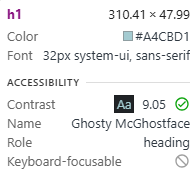
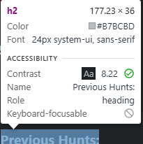
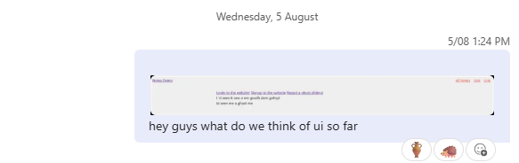
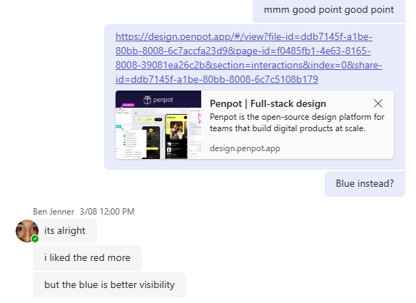
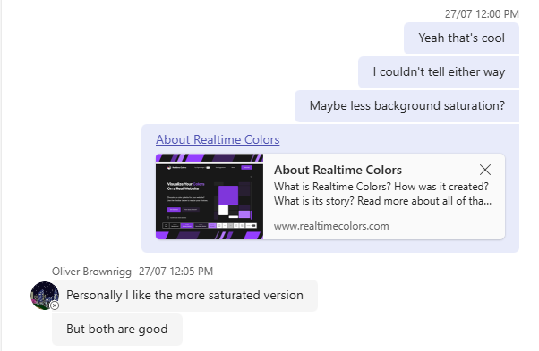
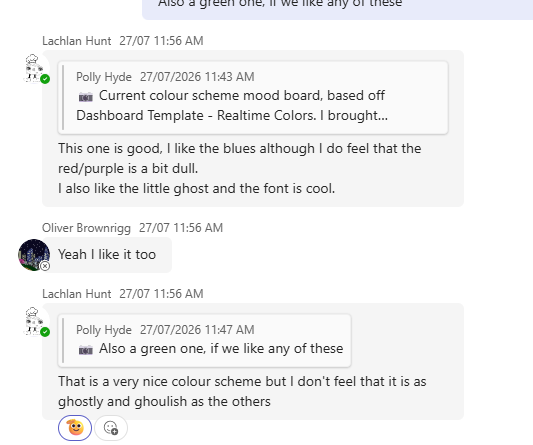
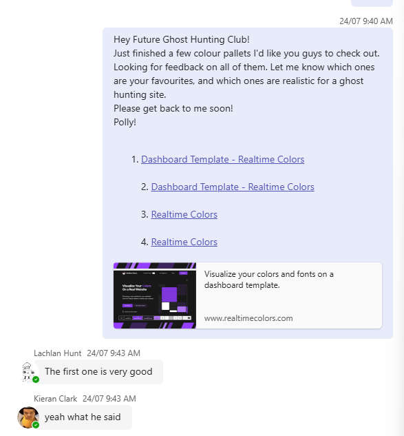
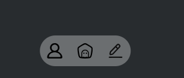

# Project Final Review and Reflection

## Addressing Relevant Implications

### Accessability
In my requirements I mentioned that the system would need to be accessible to people who require screen readers, or those who are generally low vision. 

I have made sure all images on the website have alternate text. I also made sure that text and backgrounds have good contrast, and all fonts are easy to read. 

Some fonts & Contrast scores shown below: 

### End User

To meet this implication, I made sure to iteratively discuss the website and it's features with my end users, in order to make sure the website would meet their needs/requirements, checking in with them every step of the way. 

Below are snapshots of the conversation between myself and my end users. 

### Usability

I made sure that all access to hunts were available from the home screen. Then, for other important parts (like profile editing & reporting ghosts) are  available from any page via a floating bottom bar on z-index 1000 (prioritising it over everything). I also added a bottom button for the home page, right in the middle of the bar as shown below. 

I made the navigation bar icons, rather than links, as it's more modern, takes up less space on the ui, and by using SVGs can be used to highlight the page the user is on. 

### NAME OF IMPLICATION 4

Replace this text with notes about what you did during the project to address the implication - design features, etc.

### NAME OF IMPLICATION 5

Replace this text with notes about what you did during the project to address the implication - design features, etc.

## Overall Review

Replace these words with a brief review of how the project went in terms of:
- What went well?
- What didn't go so well?
- How did the testing/trialling impact the final system?
- What would you do differently if you could?

